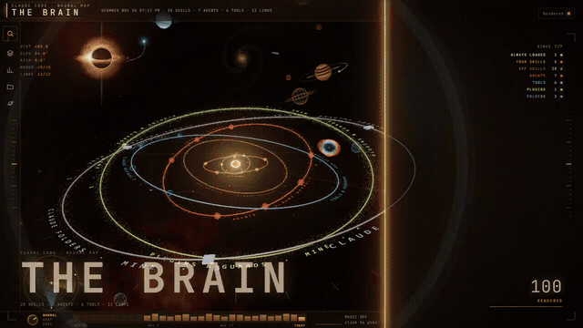

# The Brain

A live 3D map of your Claude Code setup. Your rules, skills, agents, plugins, MCP servers and folders orbit a
glowing core, and light up while Claude works.

<p align="center"></p>

Full demo video (1 minute): [docs/demo.mp4](docs/demo.mp4). The demo uses made-up sample data, not a real setup.

| | |
|---|---|
|  |  |
|  |  |

## What it shows

- The map: Everything Claude can use, in rings around the core: rules that load with every message, your
  skills, app skills, agents, tools and MCP servers, plugins and permissions, and the folders Claude works in.
  Click anything to see what it is and what it talks to.
- LIVE: Follows the chat that is running right now. Each skill, agent and tool lights up as Claude uses it.
- HISTORY: Replays any past prompt step by step.
- HEAT and COST: What you used in the last day, week or month, and how many tokens each thing adds to
  every message. Things you never use but always pay for are the first to trim.
- Health: Flags skills without a description, very long descriptions, and rules that point at missing files.
- Planets: The Brain itself and Drop Convert (a small file converter, [its own repo](https://github.com/silviu074/drop-convert))
  have pages you can fly into. The other planets are scenery.

It reads only files on your computer: the .claude folder in your home folder and the project you used Claude
in most recently. Nothing is sent anywhere. The local server listens on 127.0.0.1 only, port 8767, and stops
5 minutes after you close the window. The page loads three.js and fonts from the internet (jsdelivr, Google Fonts).

## Install

### Windows 10 / 11

1. Download **the-brain-windows.zip** from [Releases](../../releases) and unzip it.
2. Double-click **Install The Brain.cmd**. It copies the app to your user folder, downloads the official
   Node.js build from nodejs.org once (about 36 MB, checked against its SHA-256), and adds Desktop and Start
   menu shortcuts. No admin rights needed.
3. It asks if you want your plan limits (5-hour and weekly) in the Brain. Yes adds a small Claude Code
   status line, only if you don't have one, and keeps a backup of your settings.
4. Open **The Brain (Claude)** from the Desktop or Start menu.

To remove it, double-click **Uninstall The Brain.cmd**. Your Claude files are not touched.

### Mac (untested)

Download **the-brain-mac.zip**, unzip it and double-click **Install The Brain.command**. It installs to
~/Library/Application Support and adds an app to ~/Applications. **It has not been run on a real Mac yet.**
If macOS blocks it, open System Settings > Privacy & Security and click Open Anyway.

### Codex edition (Windows)

An older version of the Brain for OpenAI Codex users, from October 2026. It reads ~/.codex instead of ~/.claude
and runs on port 8766. Download **the-brain-codex-windows.zip** (Node.js is included) and run its installer.
The source is in [codex/](codex).

## Try it without your own data

Needs Node.js 20 or newer.

```
node demo/make-sample-home.mjs
BRAIN_HOME=demo/sample-home node app/scan.mjs
BRAIN_HOME=demo/sample-home node app/server.mjs
```

Open http://localhost:8767, then run `node demo/play-live.mjs` in another terminal and open the LIVE tab to
watch a made-up prompt play in. On Windows PowerShell, set the variable first: `$env:BRAIN_HOME="demo/sample-home"`.

## How it works

- **app/scan.mjs** reads your setup and writes app/data.js. The shortcut runs it on every start; the SYNC
  button runs it again.
- **app/server.mjs** serves the page and reads Claude Code's own session logs in ~/.claude/projects for HISTORY,
  LIVE and the usage numbers.
- **app/index.html** is the page: three.js for the 3D map. **app/worlds.js** holds the planets and their pages.
  To add a page for your own app, copy the convert entry in worlds.js.

## How it was made

Made with AI. I described what I wanted in plain words and Claude Code wrote the code, the installers and this
demo. I decided what it should show and how it should look. The Windows version is the one I use; the Mac
version has not been run yet.

## Credits

Space photos: ESA/Hubble and NASA (CC BY 4.0) and NASA/JPL (public domain); full credit lines in
[app/models/space/CREDITS.md](app/models/space/CREDITS.md). Earth and Moon maps from the three.js examples.
[three.js](https://threejs.org) (MIT) and [Node.js](https://nodejs.org) (MIT).

## License

[MIT](LICENSE) for the code. The images in app/models/space keep their own licenses.
