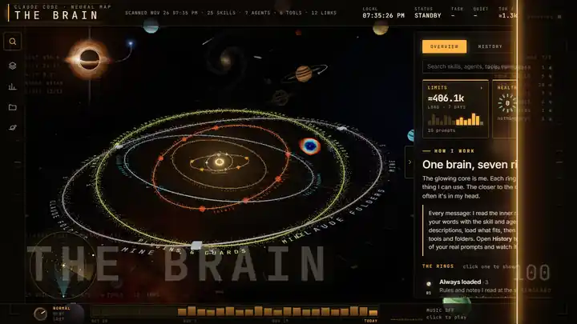
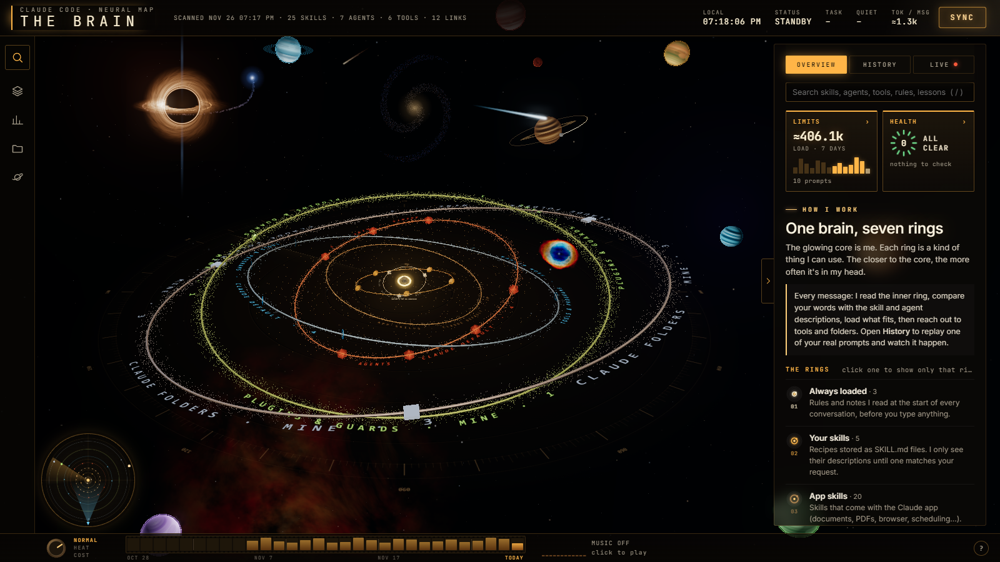
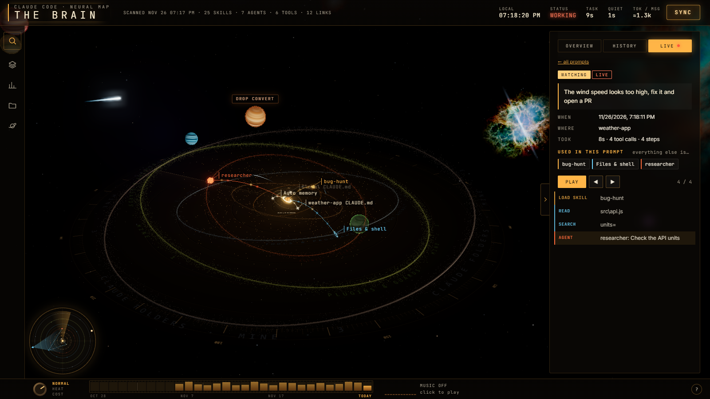
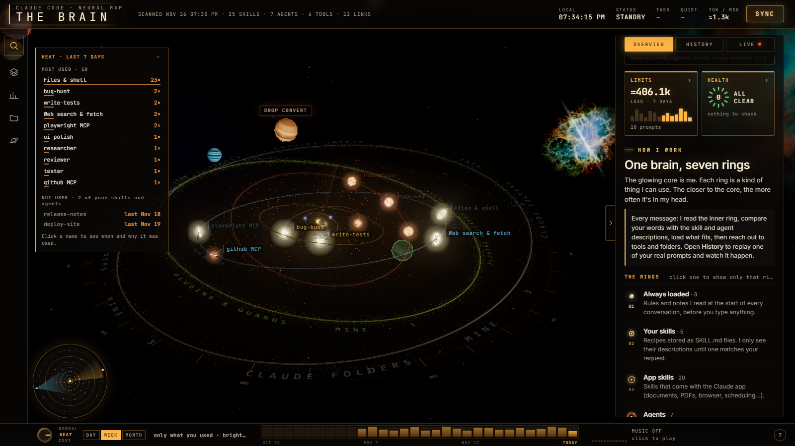
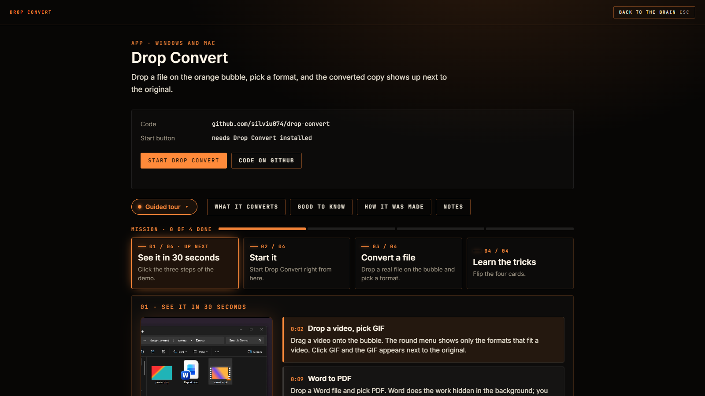

# The Brain

A visual way to follow what AI does on your computer. The Brain watches Claude Code while it works: which
rules it loads, which skills, agents and tools it uses, which files it touches and how long each step takes.
It shows all of this live on a 3D map, and it can replay everything the AI did in the past.

It is also a hub for your own apps and projects: each one can get a planet in the Brain's sky, with its own
page and a button to start it.

<p align="center"></p>

Full demo video (about 1 minute): [docs/demo.mp4](docs/demo.mp4). The demo uses made-up sample data, not a
real setup.

| | |
|---|---|
|  |  |
|  |  |

## What it shows

- LIVE: follows the chat that is running right now. Each skill, agent and tool lights up the moment Claude
  uses it, with the step list and timings beside the map. You see how the AI behaves on your computer as it
  happens.
- HISTORY: replays any past prompt step by step, so you can see what the AI did while you were away.
- The map: everything Claude can use, in rings around the core: rules that load with every message, your
  skills, app skills, agents, tools and MCP servers, plugins and permissions, and the folders Claude works in.
  Click anything to see what it is and what it talks to.
- HEAT and COST: what you used in the last day, week or month, and how many tokens each thing adds to every
  message. Things you never use but always pay for are the first to trim.
- Health: flags skills without a description, very long descriptions, and rules that point at missing files.

It reads only files on your computer: the .claude folder in your home folder and the project you used Claude
in most recently. Nothing is sent anywhere. The local server listens on 127.0.0.1 only, port 8767, and stops
5 minutes after you close the window. The page loads three.js and two fonts from the internet.

## How to use it: scroll

Scrolling is the main way to move around the Brain.

1. When it opens, scroll to draw the brain. The intro hands over to the live map.
2. On the map, drag to turn it and scroll to zoom. Click anything to see what it is.
3. Click the glowing core (or a planet), then scroll down: you fly into its page.
4. At the top of a page, scroll up to fly back out to the map.

The tabs on the right (OVERVIEW, HISTORY, LIVE) and the knob at the bottom left (NORMAL, HEAT, COST) switch
what the map shows. Press / to search, Ctrl+K to jump anywhere, Esc to fly home.

## A hub for your apps

Every planet with a name is one app or project. This edition comes with one example: **Drop Convert**, a small
file converter. The other planets are scenery.

**Drop Convert is a separate app.** The Brain only shows its page. To use the Start button on that page,
download and install Drop Convert first from its own repo:
[github.com/silviu074/drop-convert](https://github.com/silviu074/drop-convert) (Releases, then the installer).

To add a planet for your own app, copy the `convert` entry in [app/worlds.js](app/worlds.js): give it a new
id, a spot in the sky and a page. A notes file in `app/worlds/<id>.md` shows on its page.

## Handoffs: one per project

The way I use the Brain: one planet per project, and one handoff per project. A handoff is a short note the AI
writes before you close a long chat, so a fresh chat can continue the work without the old history. One
project never shares a note with another, so nothing gets overwritten.

This edition does not read handoffs; it is a habit you set up with your AI. [docs/HANDOFFS.md](docs/HANDOFFS.md)
explains it and holds instructions you can give to Claude Code (or another AI) so it starts writing and
reading handoffs for you.

## Install

### Windows 10 / 11

1. Download **the-brain-windows.zip** from [Releases](../../releases) and unzip it.
2. Double-click **Install The Brain.cmd**. It copies the app to your user folder, downloads the official
   Node.js build from nodejs.org once (about 36 MB, checked against its SHA-256), and adds Desktop and Start
   menu shortcuts. No admin rights needed.
3. It asks if you want your plan limits (5-hour and weekly) in the Brain. Yes adds a small Claude Code
   status line, only if you don't have one, and keeps a backup of your settings.
4. Open **The Brain (Claude)** from the Desktop or Start menu.

To remove it, double-click **Uninstall The Brain.cmd**. Your Claude files are not touched.

### Mac (untested)

Download **the-brain-mac.zip**, unzip it and double-click **Install The Brain.command**. It installs to
~/Library/Application Support and adds an app to ~/Applications. **It has not been run on a real Mac yet.**
If macOS blocks it, open System Settings > Privacy & Security and click Open Anyway.

### Codex edition (Windows)

An older version of the Brain for OpenAI Codex users, from October 2026. It reads ~/.codex instead of ~/.claude
and runs on port 8766. Download **the-brain-codex-windows.zip** (Node.js is included) and run its installer.
The source is in [codex/](codex).

## Try it without your own data

Needs Node.js 20 or newer.

```
node demo/make-sample-home.mjs
BRAIN_HOME=demo/sample-home node app/scan.mjs
BRAIN_HOME=demo/sample-home node app/server.mjs
```

Open http://localhost:8767, then run `node demo/play-live.mjs` in another terminal and open the LIVE tab to
watch a made-up prompt play in. On Windows PowerShell, set the variable first: `$env:BRAIN_HOME="demo/sample-home"`.

## How it works

- app/scan.mjs reads your setup and writes app/data.js. The shortcut runs it on every start; the SYNC button
  runs it again.
- app/server.mjs serves the page and reads Claude Code's own session logs in ~/.claude/projects for HISTORY,
  LIVE and the usage numbers.
- app/index.html is the page, with three.js for the 3D map. app/worlds.js holds the planets and their pages.

## How it was made

Made with AI. I described what I wanted in plain words and Claude Code wrote the code, the installers and this
demo. I decided what it should show and how it should look. The Windows version is the one I use; the Mac
version has not been run yet.

## Credits

Downloaded and borrowed things, and where they come from:

| What | Where it comes from | License |
|---|---|---|
| Galaxy and nebula photos (8 images in app/models/space) | ESA/Hubble and NASA; full credit line for each in [CREDITS.md](app/models/space/CREDITS.md) | CC BY 4.0 |
| Jupiter map | NASA/JPL/Space Science Institute, PIA07782 | Public domain |
| Earth and Moon maps | The three.js examples (github.com/mrdoob/three.js, examples/textures/planets) | Shipped in the MIT-licensed three.js repo; it does not name their original source |
| [three.js](https://threejs.org) 0.160 (loaded from jsDelivr, not included) | three.js authors | MIT |
| Fonts: [Inter](https://rsms.me/inter/) by Rasmus Andersson, [JetBrains Mono](https://www.jetbrains.com/lp/mono/) by JetBrains (loaded from Google Fonts, not included) | Google Fonts | SIL Open Font License 1.1 |
| [Node.js](https://nodejs.org) (downloaded by the installer, or included in the Codex zip with its LICENSE) | OpenJS Foundation | MIT |
| App icon (the brain with golden rings) | Made by me with Duck.ai, an AI image tool | Made with AI |

Made by our own scripts, nothing downloaded: the background music (app/audio/make_loop.py), the Mars, Neptune,
lava moon, ring, haze and rock models (app/models/make_space.py), the Drop Convert demo video, and the sample
data in demo/.

## License

[MIT](LICENSE) for the code. The images in app/models/space keep their own licenses (see above).
